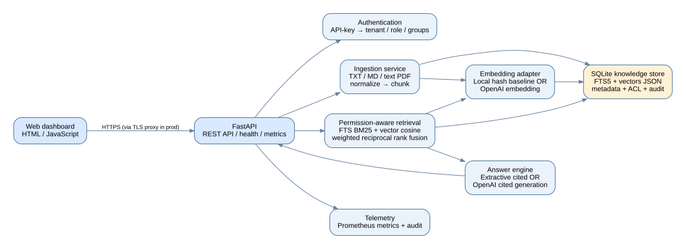

# Enterprise RAG Knowledge Intelligence Platform

A **runnable, containerized reference application**, built to demonstrate enterprise RAG engineering: text/PDF document ingestion, chunking, FTS5 BM25 lexical retrieval, 256-dimensional vectors, weighted reciprocal rank fusion, document-level tenant and group authorization, cited extractive answers or optional OpenAI answers, FastAPI, a browser dashboard, Prometheus metrics, auditing, automated tests, and synthetic retrieval evaluation.

**Deployment status:** Packaged for local Docker deployment and cloud VM deployment. The API and tests were exercised in the build environment, but **Docker and a public cloud endpoint were not available to verify an actual deployed production service.** Do not describe this package as publicly hosted or production hardened without deploying and hardening it.

**Important distinction:** The default zero-credential `local` embedder is deterministic hashed n-gram features, **not a neural semantic embedding model**. To demonstrate real neural embedding-based RAG, configure OpenAI embeddings and reindex documents. The default answer is **extractive**, not LLM-generated. Live OpenAI operation requires a valid API key and billing.

## Architecture



The corresponding **editable graph source** is [`docs/architecture.dot`](docs/architecture.dot). Typical flow:

1. Browser sends API key and search question through Nginx to FastAPI.
2. Server maps key to `tenant`, `role`, and allowed `groups` (no client-supplied tenant identifiers).
3. Ingested documents are split into overlapping chunks and indexed with SQLite FTS5 plus embeddings.
4. Search narrows candidates to the authorized tenant and groups **before ranking and response assembly**.
5. BM25 and vector cosine results are combined using weighted reciprocal rank fusion; the retrieval mode can be changed to benchmark them independently.
6. The answer mode is either cited extractive text (free/local) or an optional LLM grounded in the retrieved sources; citations and source excerpts appear in the UI.
7. Requests and retrieval latency are recorded in metrics; ingestion, deletion, and queries have tenant-scoped audit events.

## Quick start: Docker Compose (recommended)

Prerequisites: Docker Engine/Desktop with Compose v2, at least 1 GB free RAM, a free local port 8080.

```bash
unzip enterprise-rag-platform.zip
cd enterprise-rag-platform
cp .env.example .env
# Replace replace-admin-key and other sample secrets with long unique random values.
# Example: python -c "import secrets; print(secrets.token_urlsafe(32))"
docker compose up --build -d
docker compose ps
curl http://localhost:8000/healthz
```

Open **http://localhost:8080**. The UI prompts for a key from `.env`; for quick local smoke tests you can use `replace-admin-key` **only until you replace demo secrets**. Use the right-side upload form to upload `sample_data/demo_policy.md`; ask `What is the RTO?` and inspect the cited sources. Direct API OpenAPI docs: **http://localhost:8000/docs**.

The API and web container ports are bound to **127.0.0.1**, so remote access is disabled by default. If this will be exposed online, use HTTPS with a trusted reverse proxy, proper identity and secret management, observability controls, and ingress restrictions rather than opening the container ports directly.

Stop with `docker compose down`. Preserve data in the `rag_data` named volume; `docker compose down -v` **irreversibly deletes** it. Back up the volume before upgrades.

## Local Python alternative (no Docker)

Requires Python 3.12+ with FTS5-enabled SQLite:

```bash
python -m venv .venv
# Linux/macOS:
source .venv/bin/activate
# Windows PowerShell: .venv\Scripts\Activate.ps1
python -m pip install -r requirements-dev.txt
cp .env.example .env
# The app does not automatically read .env when running directly.
# Linux/macOS: set -a; source .env; set +a
# Or export RAG_API_KEYS='yourkey|acme|alice|admin|engineering,finance'
uvicorn app.api:app --host 127.0.0.1 --port 8000
```

For native Python mode, serve `web/` with a reverse proxy pointing `/api/` to the API, or use the interactive API docs at `http://localhost:8000/docs` directly. **Do not use `source .env`** when passwords include shell-special characters unless properly escaped; environment variables or a service manager are safer.

## Direct API smoke test

```bash
curl -X POST http://localhost:8000/v1/documents \
  -H 'X-API-Key: replace-admin-key' -H 'Content-Type: application/json' \
  -d '{"title":"Backup policy","content":"Database backups are retained for 90 days and verified monthly."}'

curl -X POST http://localhost:8000/v1/ask \
  -H 'X-API-Key: replace-admin-key' -H 'Content-Type: application/json' \
  -d '{"query":"How long are backups retained?","mode":"hybrid","k":3}'

curl -H 'X-API-Key: replace-admin-key' http://localhost:8000/v1/documents
```

Key endpoints: `POST /v1/documents`, `POST /v1/documents/upload`, `GET /v1/documents`, `DELETE /v1/documents/{id}`, `POST /v1/ask`, `GET /healthz`. `/metrics` is disabled unless `EXPOSE_METRICS=true`; **if enabling it, protect it using network policy or reverse-proxy auth**.

## Enable neural embeddings and LLM answers

In `.env` set:

```dotenv
OPENAI_API_KEY=your_secret_key
EMBEDDING_PROVIDER=openai
EMBEDDING_MODEL=text-embedding-3-small
ANSWER_PROVIDER=openai
CHAT_MODEL=gpt-4.1-mini
```

Then restart: `docker compose up -d --force-recreate`. **Before switching embedding providers, delete the old local indexed demo database and re-ingest**: vector scores between different embedding methods are meaningless. To reset this disposable demo completely: `docker compose down -v` **(destructive)** and then `docker compose up --build -d`. Do not run that command against databases containing valuable documents. Other model names must support `dimensions=256` or require code/config changes.

The OpenAI mode has code paths but was **not integration tested with an external API key** in the build environment. It may entail usage costs. Never upload private enterprise/customer information to a third-party model without appropriate agreements, controls, and authorization.

## Automated tests & retrieval benchmarks

```bash
python -m pip install -r requirements-dev.txt
python -m pytest -q tests
python benchmarks/run.py
```

- Tests cover authentication, admin/editor separation, multi-tenant isolation, group ACL filtering, ingestion, upload file validation, deletes, citations, retrieval modes, input limits, deterministic embedding, and health checks.
- Benchmark dataset: 30 **synthetic** policy documents, each with one expected-document question; fixed query and corpus sets, single local process, no network/API calls.
- Metrics: Recall@1, Recall@3, Mean Reciprocal Rank@3 (MRR@3), median and p95 **retrieval-only** milliseconds (not end-to-end latency).
- Results are generated into `benchmarks/results.json`, including **every question's observed rank**. Machine performance affects latency. Results are illustrative only, not a validated production accuracy or generative faithfulness test.
- To make portfolio claims robust, add a larger realistic evaluation set (100–500+ labeled queries), measure retrieval and answer groundedness separately, measure token cost, run concurrent load tests, and compare with neural embedding/reranker variants.

## Environment variables

| Variable | Description |
|---|---|
| `RAG_API_KEYS` | Semicolon-separated `key|tenant|username|role|group1,group2` entries; demo-only identity mechanism |
| `DATABASE_PATH` | SQLite DB path; default `./data/rag.db` |
| `EMBEDDING_PROVIDER` | `local` (hash baseline) or `openai` (neural embedding) |
| `ANSWER_PROVIDER` | `extractive` or `openai` |
| `OPENAI_API_KEY` | Needed for OpenAI mode |
| `EMBEDDING_MODEL` | Default `text-embedding-3-small` |
| `CHAT_MODEL` | Default `gpt-4.1-mini` |
| `EXPOSE_METRICS` | `false` by default; enable only on a protected internal interface |
| `CORS_ORIGINS` | Comma-separated browser origins |

## Security and production rollout checklist

This reference app has document/group authorization and limited upload formats, but it is **not yet a compliance-certified or enterprise-hardened service**. Before using it with sensitive data or scaling it for a company:

- Replace static API keys with OIDC/SSO (JWT signature + issuer + audience checks), service identities, key rotation, and per-user authorization from a directory.
- Enable HTTPS and secure ingress, secret management, rate limiting, abuse defenses, security logging and centralized alerting; keep `/metrics` and audit data private.
- Replace SQLite for large/concurrent workloads with PostgreSQL plus pgvector (or another supported vector search service). **This migration is a future hardening task; a PostgreSQL adapter is not implemented in this version.** Implement server-side filtering and ANN indexes with tenant isolation preserved.
- Store documents in an object store and queue indexing jobs; scan uploads for malware, enforce content limits, validate PDFs in isolated workers, and add OCR for scanned PDFs.
- Separate retrieval indexing and chat service scaling; add request timeouts/retries, per-tenant rate/cost quotas, idempotent ingest, incremental reindexing, and database backup/restore tests.
- Validate model output citations (prompt instructions alone do not guarantee accuracy); add prompt-injection and sensitive-data exfiltration evaluations, access-control penetration tests, content safety controls, and retention/deletion policies.
- Do not store plaintext questions that might contain secrets in audit events; redact or hash content in hardened deployments. Current demo stores the first 160 characters of each query for troubleshooting.
- Replace the demo user/key textbox with SSO; audit access and establish least-privilege role/group lifecycle.
- For Kubernetes/production, deploy as multiple services behind an ingress, use a managed DB and secret provider, configure liveness/readiness and resource limits, use private networking and continuous vulnerability scanning.

## Connection to your existing AI OS MVP

Treat this service as a standalone `knowledge_intelligence` domain service in your AI OS. Agent tools can call `POST /v1/ask` with **scoped service credentials**. Keep actual identity/group checks at this API boundary; don't pass arbitrary user roles/groups from an agent's prompt. Department-specific agents (HR, Finance, Operations) can query shared/public documents and their authorized departmental materials. Avoid cross-tenant service credentials.

## Resume wording (accurate once deployed and evaluated)

“Built a containerized, permission-aware enterprise knowledge retrieval application with FastAPI, SQLite FTS5, pluggable embeddings, hybrid rank fusion, a cited-answer interface, automated integration/security tests, observability, and reproducible retrieval benchmarks.”

Add real hosting links, production metrics, neural-embedding accuracy, concurrency, and business impact **only after those are measured in the intended environment**.
